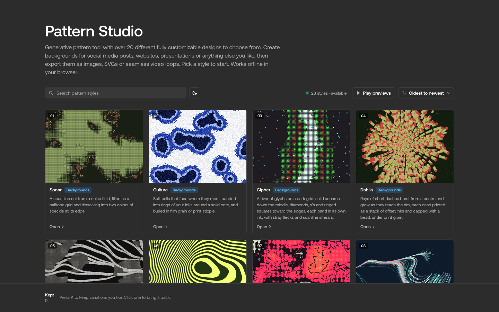
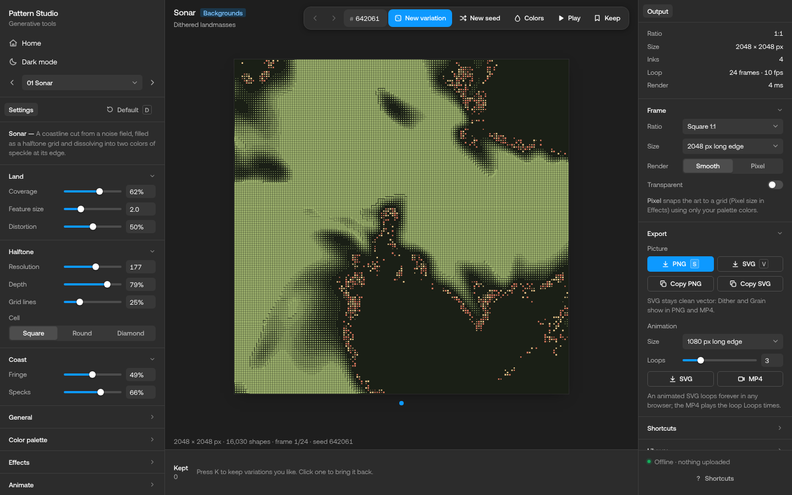
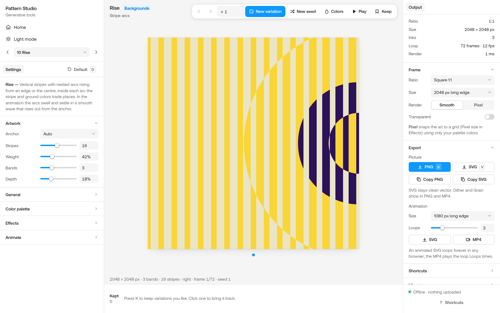
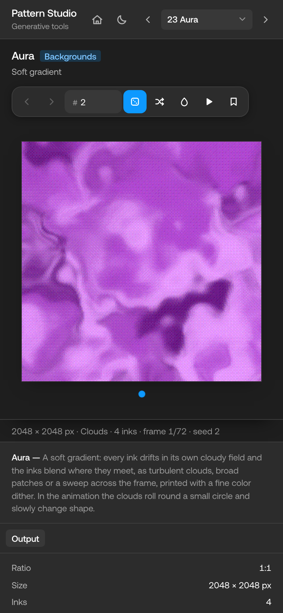

# Pattern Studio

A generative pattern tool with 23 fully customizable styles. Make backgrounds for social media posts,
websites, presentations or anything else, then export them as images, SVGs or seamless video loops.

Everything runs in the browser: no account, no server, and your patterns are never uploaded. The whole app
is a single HTML file that also works offline. The website counts anonymous visits with Vercel Web Analytics
(no third-party cookies); the app file on your computer never sends anything.



## Using it

- **Online:** the website serves `public/index.html`.
- **Offline:** open `public/index.html` in Chrome, Edge, Firefox or Safari (double-click it). It is the
  complete app in one file, so it can be renamed (for example `Pattern Studio.html`), copied and shared.

On the home page, **Play previews** plays every card's loop at once; when it's off, a card plays when you
point at it. On phones and tablets there's no button: the cards on screen play on their own. The order menu
sorts the styles: oldest to newest, newest to oldest, A to Z or Z to A.

Pick a style, then:

- **New variation** (Space, or a click on the artboard) draws a new pattern; **N** keeps the settings with a
  new seed, **C** picks new colors and **R** rotates the colors through their roles. Locked colors stay put.
- **Settings** sit in the left-hand column, under the style menu: the style's own settings, then **General**
  (Rotation and Size), **Color palette** (presets, your own palettes, hex codes), **Effects** (Grain and
  Dither) and **Animate**. Those four start closed: click a heading to open it.
- **Output** sits in the right-hand column: a summary of the picture (ratio, size, inks, loop, render time),
  the **Frame** (ratio, size, Smooth or Pixel, transparent background), **Export**, every keyboard shortcut
  and the **Library** (the shortcuts and the Library start closed).
- **History:** ← and → step through every variation; **K** keeps one in the Kept strip; **D** goes back to the
  style's default look.
- **Export:** PNG, SVG (true vector for vector styles), animated SVG and MP4 loops that join up seamlessly.
- **Library:** save a pattern as a small `.pattern.json` file and open it again later, on any computer.
  **Save app copy** downloads the app with your palettes and kept variations stored inside it.
- **Dark / light mode:** the switch by the home search, or the one next to Home at the top of a style's
  settings.
- **On a phone** it's one column: the artboard stays pinned at the top while you scroll through the style's
  description, Output, Settings (every section open) and, at the bottom, the Kept strip.



<p>
  
  
</p>

### Keyboard shortcuts

| Key | Action |
| --- | --- |
| Space | New variation |
| N | New seed (same settings, new shapes) |
| C | New colors |
| R | Rotate colors |
| D | Default look |
| P | Play / pause the loop |
| K | Keep this variation |
| ← → | Step back / forward through history |
| S / V | Save PNG / SVG |
| H | Home |
| 1–9, 0 | Open a style (0 is the tenth) |
| [ ] | Previous / next style |
| ? | All shortcuts |

In a value box (the number next to a slider, or a custom frame size), ↑ and ↓ change the number one step at a
time (Shift: ten steps), and Tab / Shift+Tab jump to the next / previous value box in that column.

## The styles

| Style | What it draws | Drawn as |
| --- | --- | --- |
| Sonar | Dithered landmasses | vector shapes |
| Culture | Grainy colony fields | pixels |
| Cipher | Glyph rivers | vector shapes |
| Dahlia | Burst posters | vector shapes |
| Coral | Sea-fan textile | vector shapes |
| Whorl | Warped op-art | vector shapes |
| Splice | Cut-up riso | pixels |
| Filament | Thread field | vector shapes |
| Stipple | Halftone dots | vector shapes |
| Rise | Stripe arcs | vector shapes |
| Prism | Pixel aurora | vector shapes |
| Motley | Glyph patchwork | vector shapes |
| Warp | Op-art pattern | vector shapes |
| Stitch | Glitched pixel grid | vector shapes |
| Quilt | Pixel blanket | vector shapes |
| Modular | Modular grid | vector shapes |
| Husk | Husk scatter | pixels |
| Mist | Neon wash | pixels |
| Atlas | Text-mode terrain | vector shapes |
| Strand | Rod chains | pixels |
| Sear | Thermal smear | pixels |
| Crowd | Blurred crowd | pixels |
| Aura | Soft gradient | pixels |

Vector styles export clean SVG shapes; pixel styles are painted pixel by pixel (their SVG holds the image).

## Project layout

```
public/
  index.html      the built app: one self-contained file (what the website serves)
src/
  index.html      page skeleton; build.py inlines the files below into it
  core/           shared engine
    pl.js           namespace and version
    rng.js          seeded random numbers and stable hashes
    noise.js        seeded 4D simplex noise (seamless loops)
    color.js        OKLab color maths, hex parsing, palette generator
    scene.js        Scene model: canvas renderer and SVG writer
    glyphs.js       Atlas Mono outlines (generated by scripts/make_glyphs.py)
    fx.js           Effects shared by every style: Grain and Dither
    tools.js        style registry
  tools/          one file per style (sonar.js, culture.js, … aura.js)
  ui/
    fonts.css       the Aeonik interface font, embedded so the app looks the same offline
    styles.css      app styles: dark and light themes, the phone layout
    app.js          the app: home page, style menu, routing, settings, colors,
                    output, history, kept strip, exports, library
scripts/
  make_glyphs.py  rebuilds src/core/glyphs.js from DejaVu Sans Mono (needs fontTools)
build.py          builds public/index.html from src/
vercel.json       hosting settings (static site, served from public/)
docs/screenshots/ the pictures in this README
```

## Building

The app is built from the files in `src/`. After changing them, run `python3 build.py` (Python 3.10 or newer, no packages needed) to rebuild `public/index.html`, the single file the website serves.

## Credits

The interface is set in Aeonik by CoType Foundry, embedded in `src/ui/fonts.css`. The Atlas style draws its letters with Atlas Mono, outlines derived from DejaVu Sans Mono (Bitstream Vera license; the license notice is at the top of `src/core/glyphs.js`).
